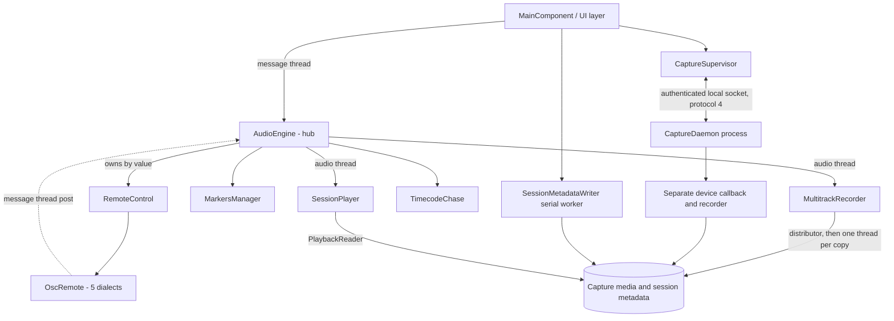

# Architecture — ZynForge Recording

## 1. Overview

ZynForge Recording is a JUCE 8 / C++20 macOS application for live multitrack recording and virtual-soundcheck playback. It captures every input channel on a front-of-house console to disk in real time, then plays those tracks back through the same outputs during a soundcheck — letting an engineer dial in the room without the band on stage.

It is **not** a mixer or DAW. No plugins, no effects, no talkback. Architectural emphasis is on real-time safety, crash-survivability of capture files, and identical state across the MIXER / EDIT / PATCH views.

## Current baseline and owned STOP/persistence work

The Mac mini and the current DMG run `281c6c0` with its matching protocol-v4
helper (installed 2026-10-29); the development Mac runs `9a40f54`, also protocol 4. Release, TSan and ASan/UBSan/float-cast-overflow
each pass 689 groups at `281c6c0` and 1586 at `9a40f54`, with zero failures and no sanitizer reports; interactive and
physical capture acceptance remains open. [INSTALL.md](INSTALL.md) owns package
identities; [the follow-up register](docs/history/REVIEW-REPAIRS-2026-10-05.md) and
[earlier S6 audit](docs/history/AUDIT-2026-10-05.md) retain separate evidence.
`main` is ahead of both builds and is on JUCE 8.0.17-security, which neither has; this
document describes `main`, and [testing.md](testing.md) holds its results.

A local STOP crosses the recorder's capture boundary once, publishes recording=false and retains a finalization lease. `AudioEngine::stopRecordingAsync` owns the worker that drains queues, closes writers, splices punches, starts integrity reporting and prepares playback readers. Only the message thread installs prepared player/clip state, including refreshed explicit-source readers after a punch; edited clip state survives but stale source descriptors do not. The owned job retires old readers off that thread before invoking its completion. Deferred device configuration waits for the same ownership boundary. Repeated STOP/start/structural mutation cannot reuse finalizing writer state. The synchronous engine entry remains for legacy callers. A daemon STOP has its own owned thread (`CaptureSupervisor::stopRecordingAsync`) and loads its media on the same worker (`AudioEngine::finishExternalTakeAsync`), through `endDaemonTake`.

`MainComponent` holds its pending capture/session guard across media completion and subsequent metadata persistence. It captures settings, mixer, project and layout into immutable serialized values. `SessionMetadataWriter` owns one serial worker for project merge/write and backup copies; it never reads UI or engine objects. Explicit/full saves keep individual ordered outcomes. Unstarted layout-only writes coalesce with one callback per job, do not save unrelated mixer edits, and the queue caps unstarted jobs at sixteen with visible rejection. Navigation stays available while timeline/session mutation is guarded. Content comparison prevents an older save from marking newer non-undo edits clean.

Save/close/switch/quit continuations run after successful, still-current persistence. UI callbacks use `SafePointer`; destruction drains accepted metadata jobs. Forced destruction during the earlier media stage can finalize owned media but cannot take a new UI metadata snapshot after the host is gone. Normal UI quit is guarded during that stage.

Snapshot retention uses chronological timestamp/numeric sequence ordering, recognizes legacy collision names, survives a backward wall clock, and excludes linked roots/candidates and unrelated journals. Files remain individually atomic replacements; the set of project/settings/mix files is not one atomic transaction. Snapshots exclude audio and cannot undo a committed punch.

## 2. Technology Stack

Validation uses macOS 26.6.2 on an Apple M1 Pro, Xcode 27.2 (macOS SDK 27.2) /
Apple Clang 21 and CMake 4.3.2; CI builds and tests on GitHub's macOS 15 runner.
Both Release architecture slices build; execution and sanitizer results are
arm64. Nothing has run on macOS 27 or on an Intel Mac. JUCE is pinned by commit
in CMake; its FLAC patch is still needed on 8.0.17-security and is applied during
configuration. Historical field takes used earlier source.
[testing.md](testing.md) records commands and limitations.

| Component | Version / Notes |
|---|---|
| Language | C++20 |
| Framework | JUCE 8.0.17-security (pulled via CMake `FetchContent` on first configure) |
| Build system | CMake 3.22+, Xcode generator on macOS |
| Platforms | macOS 12.0+, Universal (arm64 + x86_64) |
| Audio backend | CoreAudio via `juce::AudioDeviceManager` |
| Threading | `juce::AudioWorkgroup` for writer co-scheduling on Apple Silicon |
| GPU / paint | JUCE software renderer; Apple Accelerate / vDSP for FFTs |
| Network | `juce::DatagramSocket` and `juce::StreamingSocket`: OSC, console, capture daemon and twin links |
| Persistence | `juce::PropertiesFile` (app prefs) + `.zfproj` JSON (per-session) |
| Typography | Native macOS sans-serif (UI); JetBrains Mono bundled via `BinaryData` (tabular numerals) |

## Capture and session contracts — October 2026

- `TrackState::referenceMedia` is read from older sessions and written back; nothing creates it now. Default capture append length still excludes it, while explicit cursor/rolling punches retain their requested position, so an older session's generated backing bed cannot push a take to the end of that bed.
- Capture validates non-overlapping stereo pairs and compatibility with existing media before opening writers. A missing hardware input supplies silence for that channel while the available stereo side continues.
- Backup/mirror provenance binds a replica to its primary session identity. Unknown nonempty destinations are refused; relocation retains identity, while a live fork cannot claim the original's replica. Continuations pad each participating destination to the shared start position; pre-roll histories detach at one callback boundary.
- Device-stop handling closes the optional stereo-mix writer, retains the interrupted endpoint and starts one finalization on the STOP worker (`launchCaptureStopJob`), then reports `onTakeInterrupted`. Repeated STOP must not reload away subsequent edits. Daemon failure warnings survive completion.
- `captureInputGainDb` persists as the take's gain reference, with `captureInputGainKnown` saying the desk really reported it; zero dB is valid, and a session from before the flag reads a stored zero as no reference. Reopen initializes live gain from that reference and clears `liveInputGainKnown`.
- `inputPeak` contains input-only activity for auto-arm. Playback display peaks cannot trigger it, and linked stereo arms change together. Capture and LOCK still block automatic arming.
- Modern `Audio Files` and legacy root media merge per track, with modern media preferred. Explicit cross-track source identity is retained through playback/rendering, trim bounds use the actual source length, and grouped edits compute one legal delta before mutating peers.
- Delete confirmation reserves session I/O. Its callback rechecks recording and session identity before deleting or clearing state. Console reconnect preserves the saved stage patch until restoration succeeds; unknown remote state must not replace that saved patch.

The [October audit record](docs/history/AUDIT_FIXES_2026-10-03.md) maps each contract to its fix and regression coverage.

## 3. High-Level Architecture



The hub is `AudioEngine`. It owns `juce::AudioDeviceManager`, registers as the `AudioIODeviceCallback`, and on each audio block:

1. Clears outputs
2. Runs `SessionPlayer::processBlock` into a per-track scratch buffer and observes the played sample span
3. Runs `MultitrackRecorder::processBlock` (input → ring buffers); for a selected punch, only the overlapping `[in,out)` sub-block enters capture and the armed track's live input replaces old playback in monitor/direct routes
4. Applies mute / solo routing into a 64-bit accumulator (`juce::AudioBuffer<double>`)
5. Downcasts and writes to outputs, the stream bus and the optional `StereoMix.wav` writer
6. Drives meters and the FFT FIFO from the in-flight buffers
7. Steps soft-takeover ramps for cue recall

## 4. Directory Structure

```
ZynforgeRecording/
├── CMakeLists.txt
├── CLAUDE.md / README.md / architecture.md / design.md
│   tasks.md / decisions.md / coding-standards.md / testing.md / CHANGELOG.md
├── Source/
│   ├── Main.cpp                       — JUCE app entry + window
│   ├── Audio/                         — real-time + persistence layer
│   │   ├── AudioEngine.{h,cpp}        — hub; AudioIODeviceCallback
│   │   ├── MultitrackRecorder.{h,cpp} — input → audio/gap timeline → one writer thread per copy
│   │   ├── SessionPlayer.{h,cpp}      — clip-aware playback via PlaybackReader
│   │   ├── TrackState.h               — per-track atomics (peak, RMS, armed, mute, gain, …)
│   │   ├── EngineStatus.h            — serialisable status snapshot (capture-split Phase 0 boundary)
│   │   ├── Markers.{h,cpp}            — per-session marker store
│   │   ├── TimecodeChase.h            — LTC bit decoder + MTC quarter-frame accumulator
│   │   ├── StripColours / StripNames / StripGains / StripRouting  — appProps overrides
│   │   ├── FastAccumulate.h           — NEON helpers for 64-bit summing on arm64
│   │   ├── FloatAiffWriter.h          — checked AIFF-C fl32 writer
│   │   ├── OscRemote.{h,cpp}          — inbound OSC dialect parser
│   │   ├── QcAnalyzer.h               — post-show per-track QC (peak/LUFS/clips/floor), streamed
│   │   ├── SongDetector.h            — multi-track quorum song-boundary scan → markers
│   │   ├── PreflightProbes.h         — measured disk-speed / writability / headroom probes
│   │   ├── SpectrumBands.h            — band energies for the soundcheck report
│   │   ├── SessionRemovedData.h       — keeps the originals of a session that held removed features
│   │   └── CrashReportScan.h          — launch-time .ips telemetry (find/summarize)
│   ├── UI/                            — message-thread paint code
│   │   ├── SessionMetadataWriter.h   — immutable queued project/settings/mix persistence
│   │   ├── MainComponent.{h,cpp}      — root, menu bar, layout, 10 Hz refresh timer
│   │   ├── ChannelStrip.{h,cpp}       — one logical strip (mixer view)
│   │   ├── EditPage.{h,cpp}           — clip / waveform editor (page-level)
│   │   ├── EditTrackRow.h             — EditPage::TrackRow + TimelineMapper (split out of EditPage.cpp)
│   │   ├── PatchPage.{h,cpp}          — input / output routing matrix
│   │   ├── SetlistBar.{h,cpp}         — cue list + jump controls (path-drawn arrows)
│   │   ├── BigClockPanel.{h,cpp}      — hero timer + disk-health banner with pulse
│   │   ├── TransportBar.{h,cpp}       — play / stop / record (path-drawn icons)
│   │   ├── Toast.h                    — non-modal feedback pill
│   │   └── *Dialog.{h,cpp}            — modal prompts (all use DialogChrome)
│   ├── Theme/                         — design system
│   │   ├── ForgeTokens.h              — GENERATED family tokens (vendored from ZynForgeBrand)
│   │   ├── BrandColors.h              — palette, personality, accents, shadow, onSignal (values from forge::)
│   │   ├── BrandTokens.h              — type scale, spacing, radius
│   │   ├── DialogChrome.h             — unified modal chrome helpers
│   │   └── ZynForgeLookAndFeel.{h,cpp}— JUCE LookAndFeel override
│   └── Network/                       — non-audio I/O
│       ├── RemoteControl.{h,cpp}      — owns console OSC (+ log, name capture), desk macros, MIDI control surface
│       ├── ConsoleLink.{h,cpp}        — outbound console VSC (profile-based; X32 reference)
│       ├── ConsoleProfile.h           — per-console-family VSC capability profiles
│       ├── CaptureProtocol.h          — capture daemon↔GUI wire protocol (Phase 1 contract)
│       └── CaptureLink.{h,cpp}         — capture daemon↔GUI local-socket transport (Phase 1b)
│   ├── Capture/                       — headless capture daemon (Phase 1c)
│   │   ├── CaptureDaemon.{h,cpp}      — device callback + recorder + CaptureServer engine
│   │   ├── CaptureMain.cpp            — `ZynforgeCapture` console entry (2nd CMake target)
│   │   └── CaptureSupervisor.{h,cpp}  — GUI-side launch/attach/watchdog (Phases 1d+2)
├── .github/workflows/ci.yml          — GitHub Actions: build + headless suite on push/PR
└── build/                             — CMake / Xcode build artefacts (gitignored)
```

## 5. Key Components and Responsibilities

### AudioEngine (`Source/Audio/AudioEngine.{h,cpp}`)
The hub. Owns `juce::AudioDeviceManager`, the recorder, the player, markers, the remote surfaces, timecode chase and every persistent store. Implements `juce::AudioIODeviceCallback`. Exposes the public API for the UI: transport, routing, clips and takes, soft-takeover ramps.

### MultitrackRecorder (`Source/Audio/MultitrackRecorder.{h,cpp}`)
Real-time-safe input path. Per-channel `juce::AbstractFifo` buffers feed one distributor `TimeSliceThread`, which does no disk work and hands samples to a ring and a writer thread per destination (`Source/Audio/CaptureCopy.h`). WAV/AIFF support 16/24-bit PCM; WAV and AIFF-C support 32-bit float; FLAC supports 16/24-bit PCM. Periodic header flush reduces the recoverability window but does not guarantee power-loss durability. Supports a parallel backup writer with an independent format (e.g. WAV/24 primary + FLAC/24 backup), plus N extra mirror destinations. **Failover keys on a per-channel `WriterChannel::active` flag, not `writer != nullptr`** — a failed primary keeps the channel draining so backup + mirrors keep capturing (a nulled primary is otherwise indistinguishable from a deliberately-empty stereo-R slot).

### SessionPlayer (`Source/Audio/SessionPlayer.{h,cpp}`)
Real-time-safe output path. Wraps each take (`Track_NN.<ext>` + `_partXX` continuations, any of WAV/FLAC/AIFF) in non-blocking `PlaybackReader`s (`Source/Audio/PlaybackReader.h`), stitching multi-part takes via `ConcatReader`. A jump is held, silent and with the position still, until every track has its target in RAM (see the 2026-11-01 ADR *The player owns its disk reader*). Clip-aware: walks per-track clip lists, honours mute / lock / gain / fade per clip. The authoritative clip list is resolved **before** the whole-file length short-circuit, so a clip placed past a track's own file length still plays (live monitor matches the offline bounce). Session swap defers the reader-vector mutation until in-flight callbacks drain.

### UI layer (`Source/UI/`)
Message-thread only. `MainComponent` runs a 10 Hz `juce::Timer` that pulls atomics off engine + tracks and repaints. Three logical views (MIXER / EDIT / PATCH) share state through the engine — view drift is a bug, not a feature.

`MainComponent.cpp` was split (2026-05-24) along functional lines: `MainComponentTimer.cpp` (refresh tick), `MainComponentKeys.cpp` (keyboard shortcuts), `MainComponentLayout.cpp` (paint + resized), `MainComponentCues.cpp` (cue + setlist + soft-takeover ramp), `MainComponentEdit.cpp` (undo / redo / cut / paste / split / range / marker), `MainComponentSessionIO.cpp` (save / load / export / import / template ops), `MainComponentMenu.cpp` (macOS menu surface). Same pass moved clip edits, takes and playlists out of `AudioEngine.cpp` into `AudioEngineClips.cpp`.

**Remote entry points (2026-08-14).** The OSC remote and MCU surface mutate channel state through `AudioEngine::setTrackMuted/Soloed/Armed` (+ `toggle*`), never through `getTrack()` directly. Those setters mirror the stereo pair — the invariant previously lived only in `ChannelStrip::pairState`, so every non-UI surface half-updated a pair — and hold `MultitrackRecorder::getStructureLock()` across the range-check-then-use, because the message thread can free a `TrackState` between the two. `condemnAllStrips()` does not help here: it detaches components, not threads.

**macOS menu refresh (2026-06-04).** `MainComponent` is the `MenuBarModel`; macOS caches each item's enabled state until `menuItemsChanged()` is called. `MainComponentMenu.cpp::refreshMenuStateIfChanged()` polls a signature of every menu-gating condition from the 10 Hz timer and refreshes only on change — without it the menu froze in the empty launch state. The menu bar is `File · Edit · Track · Session · Help`: Edit = timeline/audio editing, the **Track** menu = channel/strip management (split 2026-06-04).

**Session transition funnel (2026-08-18).** File ▸ Open, Welcome, launch auto-reopen, command-line/Finder `.zfproj`, and second-instance document opens all call `openSessionFolder()`. The order is intentional: condemn UI objects holding `TrackState&`, stop playback, clear every session-scoped engine value, pin the directory, load audio/default clips, load `session_mix.json` with its exact track count (grow or shrink; invalid/missing falls back to loaded audio), then restore playlists and UI. Loading playlists before the player seed erased edits. `confirmSessionReplacement` wraps New/Open/CSV/Console/template/document paths so a failed save cancels the replacement. Closing and quitting likewise abort when the requested save fails.

**Transactional file operations.** Save As, Move and Show Handoff share `copyDirectoryCancellable`. It skips writers' staging files (`atomicfile::isStagingFile`) and leaves out a `WaveCache.wfm` that can't be read, which costs only a rescan; any other file that can't be copied aborts the copy. The comparison in `ShowHandoff.h` skips the same files. Save As is a clone into a new or empty directory, never a merge: save the source, copy on the owned/cancellable `sessionJobs` worker (`SessionJobRunner`), then switch by reopening the completed clone. Failure removes a newly-created partial clone and leaves the source active. Relocation rejects descendants/existing targets, saves first, uses an atomic same-volume move or cancellable cross-volume copy, and reports old-folder cleanup failure without pretending the complete destination failed. Copy/move/bounce set `sessionIoBusy` and `AudioEngine::sessionTransitionActive`; record/play/strip mutations and competing jobs fail closed until structure ownership is released. The destructor cancels and joins both export and bounce workers.

**EDIT view (`EditPage.cpp`).** `ClipEditTargets.h` resolves clip command targets; `WaveCacheFile.h` reads and writes the peak cache on `EditPage::waveCacheThread`. Each clip renders as a DAW region block: a bordered block with a name header + its own waveform drawn from the clip's file region (so move/slip-trim show the right audio; the continuous thumbnail is only the no-clips fallback). The waveform is drawn at `waveZoom × clipLinearGain`, so a clip's shape scales with its gain. Each clip carries a Pro Tools-style **gain fader** in its bottom-left corner (drag mode 7: relative ride, Alt-click → 0 dB). The per-row header column (swatch / name / I-R-S-M / slim `LedMeter` / routing) is **pinned** — drawn last via `paintHeader(g, headerOriginX())` and hit-tested through `inWavePane/inSwatch/inNameZone`, with a `ScrollViewport` that re-pins on horizontal scroll. A faint 1-2-5 s timeline grid sits behind the clips; clip Move + trim drags snap through `engine.snapSampleToGrid`. Single-key tools `S/T/R/G/F`; `Cmd+E` separates, `Cmd+H` heals, `E` zooms to selection. A row's lane and size live on its right-click menu (`TrackRow::rowMenu`), keyed by strip and saved as `ui.editRows`. Edit-menu ops Heal / Consolidate map to `AudioEngineClips.cpp` methods; all clip edits are undoable through `pushClipUndo`. Mixer ops are undoable via the coalesced `pollMixerUndo` poll (see *Undo model* in `CLAUDE.md`).

**Settings dialogs.** Three dialogs cover distinct concerns:
- `SessionSettingsDialog` — editable: audio format / sample rate / bit depth. Menu label: "Session Format & Recording...".
- `SessionInfoDialog` — a read-only summary of the open session: name, sample rate, bit depth and capture format. The name is the folder name, which is what every other surface uses; renaming means moving the folder and its `.zfproj` under a live engine, and that's Save As, not an inspect dialog. Menu label: "Session Info...".
- `AudioDeviceDialog` — a purpose-built device panel (not JUCE's `AudioDeviceSelectorComponent`): output / input / sample-rate / buffer-size combos, monitor-output picker, and a live input meter, in DialogChrome cards. It is **non-modal and floating**, so it can be open when a take starts — it watches `engine.isRecording()` on a 4 Hz timer, greys the four device combos while rolling, and refuses every path that would call `setAudioDeviceSetup()` (a device restart ends the take via `audioDeviceStopped` -> `recorder.release()`). Enforced for all callers by the invariants gate.
The format dialog and Session Info deliberately have separate concerns (edit vs inspect): collapsing them would put irreversible Format/SR changes one click away from an informational view.

### Theme (`Source/Theme/`)
Single source of truth for visual identity. `ZynForgeLookAndFeel` overrides buttons, toggles, faders, and alert boxes. `DialogChrome` wraps every modal so prompts and dialogs share the AudioDevice dialog's look (orange title stripe + flat solid `bgPanel` + footer divider).

### Network (`Source/Network/`)
`OscRemote` parses five inbound dialects (Generic, DiGiCo, A&H SQ, SSL Live, Yamaha / RIVAGE). Console dialects intentionally accept names/colours, trim or preamp-follow values and scene/marker notifications without application-token authentication; these change recorder/session state, so the interfaces are not entirely read-only. Console transport/arm/mute controls are disallowed. Generic control requires the per-start token as the final string argument.

The host intercepts all remote RECORD and STOP actions in `MainComponent::handleRemoteTransport`: both local and daemon recording use the active-session preflight, a RECORD that would punch is refused (`remoteStartInFlight`, checked in `runRecordPlan`), and a first STOP only arms the two-second guard and returns a refusal that asks for confirmation. Without a host handler, engine-level remote record/stop fail closed and the standalone transport bar cannot start/end capture; neither may create a timestamped session or bypass confirmation. `CaptureSupervisor` timestamps actual status pushes; the engine marks snapshots older than two seconds unavailable and overlays host-owned strip controls on fresh daemon meter/writer data. The backup pruner selects only timestamped snapshots, never `reorder_*` transaction journals.

`ConsoleLink` (`Source/Network/ConsoleLink.{h,cpp}`) is the **outbound** counterpart for virtual soundcheck — Behringer X32 / Midas M32 over OSC (UDP 10023). It owns one `juce::DatagramSocket` shared by an `OSCSender` + an `OscPacketReceiver` (formerly `juce::OSCReceiver`) (the desk replies to the request's source port, so send and listen must share a port); the socket is **recreated on every `connect()`** because `DatagramSocket::shutdown()` permanently invalidates the handle. Two jobs: (1) **soundcheck repatch** — `enterSoundcheck()` queries the four `/config/routing/IN/*` blocks, stashes whatever the show patch is, then sets the card-return blocks; `exitSoundcheck()` restores the stash verbatim (never assumes analog) and reads every block back; only a full read-back that equals the stash ends SOUNDCHECK, and `checkDeskPatch()` can end it with a read alone. (2) **head-amp gain capture/restore** — `captureGains()` polls `/headamp/NNN/gain`, `restoreGains()` writes them back and reads them back within one 0.5 dB step; both persist to the session's `console_state.json` so show-night state survives to VSC day. A transport seam (`setSendHook`/`injectReply`) lets `ConsoleLinkTests` assert every message against the public X32 protocol with no console attached. `ConsoleLink` is itself a `juce::Timer`: a ~1.2–1.5 s watchdog started on each routing/gain query aborts cleanly if the desk never replies (a lost UDP packet would otherwise hang the soundcheck flow), and an `opGen` counter invalidates stale timers so a late reply can't resurrect an aborted op.

**The app ignores `SIGPIPE` at startup** (`Main.cpp::initialise`): the capture and twin links write to sockets, so a peer that goes away makes the write fail with `EPIPE` instead of killing the process. Generic OSC/UDP transmits its bearer token without encryption; stronger entropy and log redaction do not provide LAN confidentiality. Use a controlled network or an authenticated encrypted tunnel where required.

### Capture-integrity + backup helpers
- **`Source/Audio/TrackFileTransaction.h`** — checked, staged media renames with `journal.json` and original metadata copies under `Session File Backups/reorder_<uuid>`. Incomplete transactions are recovered before session load; failure is surfaced without deleting recovery material. Removed tracks' media is retained under `Removed Tracks/<uuid>`.
- **`Source/Audio/FastHash.h`** — `fileSha256()`, hardware-accelerated via `CC_SHA256` (ARMv8 crypto), used by the recorder's post-stop manifest (one process-wide reader, background QoS, cooperative yields between 4 MiB read chunks). `shasum`-identical output.
- **`Source/Audio/ShowHandoff.h`** — post-show transfer verification on the owned export worker. The entire session is copied outside the active folder; every source/copy pair, apart from staging files and the waveform cache, is SHA-256 compared before channel-map/timeline CSVs and the final handoff manifest are published. A surviving incomplete marker distinguishes interrupted folders from deliverables. External backup drives are outside this transfer scope.
- **`Source/Audio/SessionBackup.h`** — `writeSnapshot()` copies the session-defining files (`.zfproj`, `session_mix.json`, `session_settings.json`, `markers.json` — never the audio) into a pruned, timestamped `Session File Backups/<Name>_<stamp>/`. Driven by manual Save, cue edits, and the auto-save timer (`MainComponent::serviceAutosave`, interval in appProps `autosaveMinutes`).

### Test isolation
`Source/Audio/SettingsFile.h` routes all five preferences writers through `makeSettingsFile()`. Tests and `--isolated-settings` smoke launches enable process-wide isolation and share a uniquely named temporary `zynforge-tests-<UUID>.settings` within that process. Re-enabling audio initialization cannot switch those writers back to production preferences. Suites must still clean up shared per-strip state between tests; see [testing.md](testing.md).

### MIDI control surfaces (`Source/Audio/McuProtocol.h` + `MidiControlSurface.{h,cpp}`)
`McuProtocol.h` is a header-only, hardware-free set of Mackie Control Universal encode/decode helpers (fader law, button notes, V-pot relative encoders + ring, channel-pressure meters, scribble-strip SysEx, **master fader on MIDI ch 9, jog wheel on CC 0x3C, and the 10-digit time display**) — fully unit-tested in `Source/Tests/McuProtocolTests.cpp`. `MidiControlSurface` opens a paired MIDI in/out, runs a 15 Hz echo timer, and is bidirectional: inbound faders/V-pots/buttons/jog drive channel + transport state (channel writes use guarded engine setters with stereo-pair semantics; transport is marshalled to the message thread), and the timer pushes faders, LEDs, meters, names, the master fader and the playhead time display back to the surface. Banked 8 strips at a time. Wired from the Control Surfaces dialog (`enableControlSurface`/`disableControlSurface` on the engine).

### Fix-round components (2026-11-02)

- `Source/Audio/DeviceChoice.h`: the rules for which device is the chosen one, what opens at launch, and when RECORD asks. `AudioEngine::noteChosenDevice`, `openChosenDevice` and `reopenChosenDevice` act on them; `serviceChosenDevice` is the 1 Hz watch.
- `Source/Audio/CallbackWatchdog.h`: compares `callbackCount` with wall time from outside the callback, in the app and in the daemon.
- `Source/Audio/CheckedAudioReader.h`: `CheckedInputStream` and `CheckedAudioReader` turn a short or failed read into a failure, behind `ConcatReader::create`. `openPlaybackReader` is the path for playback and drawing.
- `Source/Audio/TrackOrderLog.h`: `.zynforge-track-order.json`, the session's record of every strip move, which copies follow on their own threads.
- `Source/Audio/WavRepair.h`: restores a WAV's tail after a crash, beside `AiffRepair.h` and `FlacRepair.h`.
- `identity::TakeClaim`: a flock per session in the private capture folder, which says a helper still holds that session.
- `Source/UI/AlarmBanner.h` holds a list and takes turns; `AudioEngine::punchRefusal` is the punch rule; `ConsoleLink::getHealth` reports the desk from its probe.

### Fix-pass components (2026-11-01)

- `Source/Audio/CaptureCopy.h`: one thread and ring per destination of a take. Its state is shared so an abandoned copy's thread can outlive the recorder.
- `Source/Audio/AiffRepair.h`, `FlacRepair.h`: repair a header older than its audio, from `recoverInterruptedPunches` and session open.
- `Source/Audio/PlaybackReader.h`: the player's RAM-block reader, with a cue and a second read position.
- `Source/Audio/SincResampler.h`: windowed-sinc conversion for exports and imports.
- `Source/Audio/TimelineCut.h`: the one position mapping for Crop and Ripple Delete.
- `Source/Audio/SessionMixFile.h`, `SessionRepair.h`: the guarded writer of `session_mix.json`, and moving damaged session files aside at open.
- `Source/UI/RecordPosition.h`: what RECORD does at a position, shared by RECORD, the header pill and pre-flight.
- `Source/UI/ClipEditTargets.h`, `WaveCacheFile.h`: EDIT's clip command targets and its peak cache.
- `Source/UI/SerialWorker.h`: one low-priority worker that always joins, for jobs that would otherwise want a `ThreadPool`.
- `MainComponent::analysisJobs`: a second `SessionJobRunner` with its own flag and no session reservation, for QC and song scans.
- `Source/UI/BackupMirrorDialog.h`: File ▸ Backup & Mirror Drives and the BACKUP button. Backup is the first row, with a format box like the mirror rows. Backup format persists as appProps `backupFormat`, default WAV 24, and reaches the daemon in `captureDaemonSettings`.
- `ExportAudioDialog` (`Source/UI/ExportDialog.{h,cpp}`): File ▸ Export ▸ Export Audio. Raw takes, Edited tracks or Stereo mix, each through the render path it always had.
- `Source/Audio/SessionRemovedData.h`: see *Sessions from earlier builds*.

### Market-moves components (2026-10-31)

- `Source/Audio/SceneFollow.h`: the pure rule for a console scene recall, plus marker navigation. Applied by `RemoteControl::onConsoleScene`, which both console paths call.
- `Source/Network/DeskMacro.{h,cpp}`: `DeskMacroListener`, an opt-in `OscPacketReceiver` with one pinned source. Owned by `RemoteControl`, created on first start; message thread after the reader's source filter.
- `Source/Network/ConsoleLog.h`: one line per console message. `RemoteControl::logOsc` is the single sink. `RemoteControl::Host` carries `sessionIoBusy`, the status line and the EDIT scroll from `MainComponent`.
- `ConsoleEvent::Type::StereoLink`: read tier, X32/M32 only. `ConsoleLink::onTraffic` feeds the log.
- `Source/Audio/BwfStamp.h`: bext chunk walker, the one post-close 8-byte patch, and `sTRK` channel names. Called from `MultitrackRecorder::stampTakeFiles`, after every writer closed and before the hash thread starts.
- `Source/Audio/ChannelAlarm.h`: the dead-channel tiers. The audio thread stores one relaxed `TrackState::lastInputSignal` per block; `MultitrackRecorder::evaluateChannelAlarms` runs the `Monitor` off the audio thread, from the status snapshot and the daemon's status loop.
- `Source/Audio/ClockSource.{h,cpp}`: reads the device's clock source through the HAL, only on `clocksource::Probe`'s own thread, with a bounded wait.
- `Source/Audio/SessionInterchange.h`, `ReaperProject.h`, `DawProject.h`, `ProjectExport.h`: capture, resolve and write DAW projects. `SongExport.{h,cpp}` cuts marker ranges through the absolute window grid of the mix render.

**Twin Recorder link** (`Source/Network/TwinLink.{h,cpp}`). `TwinLink` is owned by `MainComponent` and reaches the app only through `twin::TwinHost`. Three threads: the link worker owns every socket; the report thread edits `session.report.json`, so a slow disk cannot look like a dead link; the message thread runs all logic. The worker authenticates frames and posts `Event`s to an inbox, which `tick()` (10 Hz, from `timerCallback`) and an `AsyncUpdater` drain. Outbound commands wait in `outbox`, and the latest status sits in a one-slot `publishedStatus` that the worker sends every 500 ms itself, so a stalled message thread does not read as a dead link. Wire format is newline JSON: `twin.hello`, `twin.auth`, `twin.accept` or `twin.refused`, then `twin.frame { seq, body, mac }`. A frame's body is one of `status`, `start`, `startResult`, `stop`, `stopResult`, `marker`, `summary`.

## 6. Data Flow / Core Workflows

### Capture daemon — protocol 4 on both Macs and the current DMG

The optional `CaptureDaemon` owns its own device callback and recorder. `CaptureSupervisor` discovers the sibling build executable or bundled `Contents/MacOS/ZynforgeCapture`; local installation must package both targets. The newline-delimited JSON contract in `CaptureProtocol.h` uses protocol 4: a compatible Hello and mutual HMAC-SHA256 proof with fresh nonces and a checked per-user capability must complete before any command is delivered. Authenticate a replacement controller before evicting the current one. Candidate handshakes are serialized, so an unauthenticated candidate can delay another attach by roughly 1.7 seconds while the existing controller remains retained. Both Macs and the current distribution package have the `443c769` protocol-4 pair. Upgrade GUI/helper together after capture ends. It includes `ConfigureCapture`: device XML, sample rate, channel routing/arms/stereo/name/UUID state, pre-roll and backup/mirror configuration are acknowledged before starting. Failed repeated idle configuration is backed off; unchanged track count does not reset pre-roll, and a failed configuration re-attaches the existing audio callback.

Daemon startup allocates the requested track storage before registering its audio callback. Capture maps physical inputs through the configured routes and freezes capture arms for the take. A START while capture is already rolling is refused before the continuation position or failure latches can change; a START after a completed stop creates a continuation part. Start/Stop status publication is ordered with command acknowledgement; socket writes occur outside the daemon's command lock so a slow status client cannot prevent STOP from finalizing audio. The GUI does not clear recording or reload completed audio until STOP confirms capture ended. The reply separately carries command acceptance and completion, so a stopped take with report/finalization errors cannot masquerade as clean success. `EngineStatus` supplies active session path, recording state, timeline position/rate, primary/backup/mirror/recovery/report failures, skipped mirrors, and disk health. `AudioEngine::isRecording()` includes external capture so GUI, edit and remote playback guards see the daemon take. The supervisor may escalate shutdown only after an accepted Quit response, never on a stale idle snapshot. A separate daemon is process isolation, not protection against computer/power/interface failure; rehearse the chosen mode explicitly.

### Reorder and deletion transaction

`AudioEngine::reorderTracks(oldIndicesInNewOrder)` is shared by move/swap/delete. UI moves operate on complete mono/stereo blocks; deletion omits those blocks. The transaction stages all affected media, reindexes survivors and archives removed files, remaps explicit source references, copies track settings/identity, reorders clips/takes and saves mix/project metadata. `onTracksReordered` invalidates old index-based undo/clipboard state. The transaction touches the primary only: it appends the move to `.zynforge-track-order.json`, and each backup and mirror follows that log on its own thread at its next take, one transaction a step, so a copy's drive is never touched on the message thread. That first take does the copy's renames with its ring holding the audio, so a very slow drive could cost that copy audio. A move that would part the two halves of one stereo file, or that runs while a lead-in is still owed, refuses before anything moves. Shared settings are written through their actual zero-based stores; UUID writes are committed after other stores' reloads.

Recovery runs before destructive session clearing. A pending journal is not temporary trash; preserve it and its audio/metadata if recovery fails. Simulated failures/interruption are tested; physical power-loss durability is not certified.

### Clip and session identity

An initialized empty playlist is authoritative silence, distinct from a missing/uninitialized list. Imports snapshot and restore existing playlists. Explicit sources carry `sourceChannel`, `fadeCurve` and session-relative `sessionAudioFile`; old `audioFile` basenames remain readable. Missing explicit media renders silence rather than substituting destination audio. Clips can extend playback length and populate unrecorded destination tracks. Loops render boundary-spanning chunks within the same callback.

`session_mix.json` now persists strip UUIDs; legacy cue snapshots without authoritative session IDs can be rebound by saved physical order. `session_settings.json` restores capture format, pre-roll, loop region and sample rate; loaded media rate is authoritative, with project rate as legacy/empty-session fallback. Autosave pauses during session I/O jobs. Default-template menu IDs are 2000–2099, separate from analysis commands.

### Recording a take

```mermaid
sequenceDiagram
    User->>MainComponent: Click RECORD
    MainComponent->>AudioEngine: startRecording(sessionDir)
    AudioEngine->>MultitrackRecorder: open writers + set recording=true
    loop every audio block
        CoreAudio->>AudioEngine: audioDeviceIOCallbackWithContext
        AudioEngine->>MultitrackRecorder: push input → AbstractFifo
        Note over MultitrackRecorder: distributor TimeSliceThread fills each copy's ring<br/>one thread per copy writes audio/gap timeline → selected format
    end
    User->>MainComponent: Click STOP
    MainComponent->>AudioEngine: stopRecordingAsync() after STOP guard
    AudioEngine->>MultitrackRecorder: end capture at callback boundary
    Note over AudioEngine: owned media worker drains, flushes,<br/>closes/splices and prepares playback readers
    AudioEngine-->>MainComponent: install readers on message thread; media outcome
    MainComponent->>SessionMetadataWriter: immutable metadata save + snapshot
    SessionMetadataWriter-->>MainComponent: completion or failure
    Note over MainComponent: release finalization guard; retain failures
```

**Inside the recorder (2026-10-29).** `MultitrackRecorder::startRecording` is a list of named stages over one `TakeStart` working-state struct (defined in `MultitrackRecorder.cpp`), all under `structureLock`: `validateTakeStart` → `createTakeFolders` → `resolveTakeMirrors` → `claimTakeCopies` → `recoverTakeCopies` → `resolveTakeFormats` → `prepareBackupCopy` → `resolveMirrorFormats` → `continuationBasesIntact` → `noteExistingPrimaryBases` → `stashPunchBases` (first stage that moves media) → `measureContinuationBase` → `openTakeWriters` → `padNewTrackLeadIns`, then `abandonTakeStart` on a hard open failure or `goLive`. `finishFinalization` likewise: `quiesceWritersForStop` → `snapshotTakeAtStop` (a `TakeStop`) → close + `reattachWriterShards` → `splicePunchedTracks` → `manifestSessionMedia` → `buildSessionReport` (a by-value `SessionReport`) → `publishSessionReport` (synchronous metadata report, then the background SHA-256 pass).

Recorder finalization first writes metadata to `session.report.json`: counts, sample totals, missed samples and file lists, with `sha256Pending:true`. Local async STOP performs this on its owned media worker; compatibility and daemon callers remain synchronous. A background-QoS thread then hashes every listed audio file sequentially with 50 ms yields between 4 MiB chunks and rewrites the report with SHA-256 sums (`sha256Pending:false`). On a continuation, the report enumerates the entire on-disk session and accumulates earlier capture warnings and elapsed counters. A hash failure sets `sha256Failed`; a failed final report write is surfaced to the local app. The immediate metadata report remains available if the background pass is interrupted. A pending report is incomplete evidence and `verify_take.sh` rejects it.

Before opening a fresh writer, the recorder checks for an existing base `Track_NN` in WAV, FLAC, AIFF, or AIF form. Existing media requires an explicit continue/punch path; an unreadable session is never treated as permission to replace it. Redundant destinations are counted only after their nested session/audio directory and writers open. Start-time skips and runtime failures are latched for status/reporting, while free-space estimates group writer byte rates by physical volume so two copies on one disk do not claim twice the endurance.

For a punch, all active copies must have a matching base before any file is stashed; every stash is completed before a writer opens. Originals remain as `.punchbase` until splice commit. Session reopen restores interrupted originals and archives partial replacements under that session's `Session File Backups/Interrupted Punch*`; recording start also checks configured backup/mirror copies. Capture history pre-roll applies only to fresh takes. A newly armed track in a punch or continuation gets a silent lead-in to align its flat file with the session timeline. A selected punch opens capture before pre-roll, gates input exactly in the audio callback, disables loop wrapping temporarily and lets the timer handle only finalization/post-roll.

### Virtual soundcheck playback
1. `SessionPlayer::loadSession(dir)` resolves supported WAV/AIFF/FLAC base files and continuations per track, merging modern and legacy layouts, and prepares buffered readers.
2. UI calls `engine.startPlayback()`.
3. Per-block: player reads each track at the current position, applies clip-aware gain / fade, emits to a scratch buffer.
4. `AudioEngine` routes scratch → per-channel outputs through mute / solo → 64-bit accumulator → downcast → device outs. Playback start refuses while ordinary local or external capture is active; the explicit selected-punch capture window permits playback for its pre/punch/post-roll and switches armed tracks to live input only inside the captured span.

### Offline render (bounce / consolidate / QC)
Edited tracks, Stereo mix (both reached from File ▸ Export ▸ Export Audio) and Consolidate all run through a **windowed** arrangement render core in `AudioEngineClips.cpp` so memory stays O(window) regardless of show length (a multi-hour mono track no longer needs a ~2 GB flat buffer). `forEachArrangementWindow(track, start, end, consume)` and `forEachStereoMixWindow(total, consume)` render fixed 64 k-sample windows and hand each window to a callback. The stereo mix applies the same rules as live playback: both call `Source/Audio/MixKernel.h` (solo and mute gate, fader floor, pan law, master gain). `bounceTrackArrangementToWav` / `bounceStereoMixToWav` stream those windows straight to a 24-bit WAV writer; `renderTrackArrangement` / `renderStereoMix` are thin buffer-returning wrappers over the same core for tests and short material. Consolidate is a named session job: `prepareConsolidate` fixes the work on the message thread, `renderConsolidate` runs on `sessionJobs` and writes 32-bit float, and `publishConsolidate` commits each clip list that has not changed since. A failed read fails the job (`ConcatReader::create`). Post-show QC (`QcAnalyzer.h`) and song detection (`SongDetector.h`) likewise stream in blocks rather than loading tracks into RAM.

### Cue recall with soft-takeover
1. UI invokes `jumpToCue(idx)`.
2. Engine arms a soft-takeover ramp per strip (`rampSamplesRemaining`).
3. Audio thread's `tickRamps(numSamples)` advances `gainDb` / `pan` toward the cue's captured values block-by-block.
4. Strip identity is resolved by `stripId` (UUID), not array index — survives a reorder.
5. A cue holds the show patch (`vsc::showOutput`). During VSC `vsc::recallOutput` writes a recalled output to the saved patch and leaves the strip on its input's channel.

### Session persistence
- Per-session (authoritative): `session_mix.json` carries the full per-strip mixer state — name, colour, gain, pan, mute/solo/monitor/arm, routing, stereo, edit group, output mute, stream send and the capture gain reference — plus the chase start and stream output pair. `.zfproj` carries setlist, cues (with strip UUIDs), playlists (Takes), media lengths, UI layout, and `formatVersion`. `markers.json` carries markers.
- Loading a session starts from `AudioEngine::clearSessionState()` and treats the persisted `trackCount` as exact, except that zero strips over existing audio falls back to the audio count. Invalid/missing mix JSON returns false so the open funnel reconstructs the mixer from audio; previous-session strips, cues, stereo flags and loop state never survive as fallback values.
- Auto-save writes on every configured interval, not only when the undo-stack count changes. Recordings, routing, cue recalls and imports are legitimate state mutations that do not necessarily add undo units. The clean baseline advances only after every live metadata write and the backup snapshot succeed; failure is surfaced and retried after 15 seconds, doubling up to the interval. An unloaded session is skipped with a status line and no retry.
- Cross-session: `appProps` (`~/Library/Application Support/Zynforge Recording/`) carries app-global prefs (sessions root, LTC source strip, default template, backup folder and format, mirror roots, active-session dir for relaunch). New sessions wipe the per-index appProps overrides; the session files are authoritative.

### Sessions from earlier builds

`Source/Audio/SessionRemovedData.h` decides whether a session's documents hold a value only a removed feature wrote. Keys alone mean nothing: earlier builds wrote them on every save, at their defaults. `removeddata::keepOriginals` copies the `.zfproj` files, `session_mix.json`, `session_settings.json` and `markers.json` to `Session File Backups/Before Feature Removal/`, through a staging folder and one rename, so the folder is complete or absent, and "once" rests on it existing. It runs at both places a session's mixer enters memory, `openSessionFolder` and `adoptDaemonTakeSession`, before anything loads. It runs again in `writeSessionMetadata` and `sessionmix::write`, which refuse the write when it fails, so a failed copy can never be followed by a save that drops the data. Retention only touches folders named `<session>_<stamp>`, so this folder is never pruned, and `sessionrepair::newestBackupOf` never offers it. Audio is never touched. Old values are otherwise ignored; `automation` stays in an old `.zfproj` after a save, because a save merges into the project file and leaves keys it does not own. An old session's bus strip loads as an ordinary strip, and the playlist model keeps a session's several takes, playing the active one.

### Capture destinations: probes, late opens and finishing

`VolumeProbe` (`Source/Audio/VolumeProbe.h`) reads one destination's volume on a detached thread that owns only its shared state, so a `statfs` that never returns strands that thread and nothing else. `startDiskWatch` builds one per copy just before go-live and finalization drops them. `readDiskEstimate` loads atomics only, groups copies by `f_fsid`, leaves a stale copy out of the figure without touching the primary's, and gives no figure for a stale primary. A reading is stale at 15 s.

A take start settles only the primary before go-live. Every other copy gets a ring and a `CopyOpen`: plain values, run first on that copy's own thread. It applies, in order, root collisions, folders, identity claim, interrupted punch, the strip moves it has not made, existing format, orphaned parts, same base as the primary for a punch, the punch stash, continuation lengths, then the files, lead-ins and their markers. A failed rule returns a sentence naming the copy, `CaptureCopy::leaveTake` takes it out of the rings, and the sentence stays in `CaptureLatches::dropped`, because the thread can outlive the recorder.

`finishFinalization` runs the primary's stages inline, then `finishCopyFiles` starts a `CopyFinish` on each copy's own thread. A `CopyFinish` holds plain values only, so its thread can outlive the recorder. `waitForCopies` applies the limits, and `TakeStop::punchVerdicts` is how a copy follows the primary's decision on each track.

`EditPage::holdWaveformsForTake` replaces the file lookups of `setWaveformsFromSession` while a take is on disk. `MarkersManager::deferDiskWhile` sends saves to a writer thread during a take and queues them behind a running write, so an old list can never land on a newer one. `ConsoleLink::setSessionDir (dir, false)` postpones reading the state file until the next call with `true`.

### Follow-up capture and external-input contracts

- FIFO samples and gaps share one absolute capture timeline. Each channel has
  256 bounded gap descriptors (4 KiB); when these fill, new samples are counted
  as missed and extend the trailing gap until the consumer frees descriptors.
  Short `captureBoundary` sections reserve metadata; consumer copying, buffer
  allocation and disk writes occur outside that lock. Stereo sides retain their
  own gap positions and share the final timeline length.
- `FloatAiffWriter` writes AIFF-C `fl32`. Capture finalization checks primary,
  backup and mirror flush outcomes before publishing reports. Exports preserve
  an existing destination on failure; punch removes unpublished partial output.
- Session reset batches five shared settings transactions. Initial mixer undo
  registration captures an already-applied gesture without replaying settings;
  actual undo/redo still applies the saved state.
- File-chooser completion rechecks local/daemon capture and finalization before
  import or bounce starts. Space can stop running transport through the save
  busy gate, while LOCK and the ordinary two-tap capture guard still apply.
- Gain capture completes only after every requested headamp index responds;
  incomplete snapshots cannot be restored. MIDI realtime bytes are independent
  events even inside fragmented/running-status/SysEx messages. Generic OSC's
  final token is excluded from command payload arity.
- The soundcheck report's band measurement (`SpectrumBands.h`) reads only an
  acquire-published FFT snapshot and leaves its release to `ChannelStrip`'s
  10 Hz timer on the same thread.

### October bug-hunt contracts (2026-10-29)

- **Punch timing.** A punch take locks the player (`SessionPlayer::setSeekLocked`, set in `AudioEngine::startRecording`, cleared by both stop paths): `setPositionSamples` and loop-on are no-ops for every caller. The audio callback passes each block's playhead to `MultitrackRecorder::processBlock`; the first live block of a punch records `punchCaptureOrigin`, which becomes the take clock base and the splice point.
- **Punch splice.** The primary copy decides. A backup/mirror that cannot splice keeps its pre-punch take and is reported failed; a primary failure rolls every copy back. Unspliced punch audio moves to `<copy>/Session File Backups/Unspliced Punch <time>/`. A punch that captured nothing is not a failure.
- **Deferred lead-ins.** `openTakeWriters` reserves part slots for any copy with less audio than the timeline position, and opens the pass's audio after them. `writeLeadInMarkers` records each reservation in `Audio Files/Pending Lead-ins/`; `completeLeadIns` (finalization) fills the slots with silence from the real timeline start; `recoverInterruptedPunches` completes leftovers. Such a track's take is `Track_NN` (silence) + `Track_NN_partKK` (audio).
- **Pre-roll** is sized in `goLive` and written by each copy's own thread before that copy's first live sample, so a slow dump costs that copy alone. Each ring has room for the pre-roll on top of its usual margin (see *The ring is sized for the pre-roll* in [decisions.md](decisions.md)).
- **Inbound OSC** (`OscRemote`, the console link's `OscUdpTransport`) uses `OscPacketReceiver` (`Source/Network/OscPacketReceiver.h`): its own receive thread and a bounds-checked parser that caps bundle nesting at 8, delivering on the message thread through `juce::OSCReceiver::Listener`.
- **Input routing.** `TrackState::inputRouting` is the requested patch and the only value persisted; `effectiveInputRouting()` wraps it onto a smaller device for the callback, the views and record-start checks.
- **Timecode chase.** `TimecodeChase` LOCKs only on decoded, consecutive LTC frames, with fps from the sync-to-sync period; only the selected source feeds and reports liveness. `SessionPlayer` advances position and wraps loops with a compare-and-swap from the block start, so a locate during a render survives.
- **Clip fades.** A clip's fade can be part of a longer ramp (`fadeIn/OutRampSamples`, `...RampOffsetSamples`); `clipFadeGain()` is the one envelope for live playback and offline renders, and `clipSlice()` cuts pieces that keep it.
- **Session lifecycle.** `createSessionFolderStructure` refuses under a take; New Session clears undo; analysis tools refuse during a take; crash recovery never lists a session a helper may be writing, and clears a marker only after a successful open.

## 7. Technical Decisions and Constraints

- **No plugin hosting** — see `decisions.md`. The product is a recorder + VSC, not a DAW.
- **macOS only** — no Windows or Linux build, by owner decision (2026-10-31). CoreAudio is assumed. Apple Silicon optimisations (NEON, `AudioWorkgroup`) are first-class.
- **Thread model** — the message thread and the audio thread are the only threads with UI / audio responsibilities. Capture runs on one distributor `TimeSliceThread` the engine owns plus one thread per copy of a take. No thread pool, and no thread is killed: see the 2026-11-01 ADR *No thread is killed*.
- **`std::atomic` is the only RT-safe message channel** between message and audio threads. No locks in the audio callback.
- **Persistence first** — every user-visible state round-trips through `.zfproj` or `appProps`. See ADR *Persistence first* in `decisions.md`.
- **Design system is the source of truth** — every painted surface goes through `brand::*` tokens + `dialog::*` helpers. See `coding-standards.md`.

## 8. Future Considerations / Known Limitations

- **`AudioEngine` remains a large shared hub.** Consumers such as TransportBar and EditPage hold a full `AudioEngine&` because they reach through `getPlayer()`/`getRecorder()`.
- **`MainComponent.cpp` is already split** along functional lines (`MainComponentTimer/Keys/Layout/Cues/Edit/SessionIO/Menu/Strips/Help/Tools/...`); see §5. Stereo logical↔physical mapping now lives on `AudioEngine`, not the UI.
- **Headless unit tests exist** (`Source/Tests/`, `juce::UnitTest`, compiled into the separate `ZynforgeRecordingTests` app against the shared `ZynforgeCore` static library -- the shipping recorder links the same library without them): recorder/player state, clip edits, recording integrity and continuations, long-take live peak retention and ring wrap, exact session reset/load, multipart completeness and numeric ordering, transactional metadata/media writes, audio-callback routing, markers, pre-flight probes, post-show QC, song detection, crash-report scan, network/OSC security, capture daemon, console links, handoff verification and EDIT mapping. **CI runs the full suite on every push/PR** (`.github/workflows/ci.yml`, macos-15). See `testing.md`. UI paint/hit-test/modal flow is still out of scope for the suite and must be field-tested.
- **Capture isolation is optional.** In-process mode shares GUI failure risk; daemon mode supports separate capture and reattachment as described above. Neither mode has completed the planned SD5 rig's acceptance rehearsal on this build.
- **Dante reaches the app through CoreAudio**, using an appropriate hardware driver (such as the RME AoX-D) or a software soundcard. Dante Virtual Soundcard is not required when a hardware interface supplies the channels. The app does not implement native Dante routing/control.
- **Workspace layout per show** is persisted globally, not per session yet. Edge case: an engineer with multiple regular gigs may want layouts saved alongside `.zfproj`.
- **LSP diagnostics are unreliable** — the project's `clangd` setup does not see JUCE module headers, so "undeclared identifier 'juce'" warnings are stale. The build is authoritative.

## Implementation notes (moved from CLAUDE.md, 2026-10-29)

For ad-hoc architecture questions, the source of truth is the code itself — start from `Source/Audio/AudioEngine.{h,cpp}` and `Source/UI/MainComponent.{h,cpp}`. Clip/take + offline-render logic lives in `Source/Audio/AudioEngineClips.cpp` (offline renders are **windowed**: `forEachArrangementWindow` / `forEachStereoMixWindow` render fixed 64k-sample windows so memory stays O(window) on multi-hour shows; `bounceTrackArrangementToWav` / `bounceStereoMixToWav` stream those windows straight to 24-bit WAV and are what Export Audio uses — `renderTrackArrangement` / `renderStereoMix` are the buffer-returning wrappers for tests/short material; `pasteClip` carries a per-clip `audioFile` for cross-track paste; **`healSeparationAt/Range`**, **`consolidateRange`** (flatten a range to a new flat file), **`setClipName`/`setClipGainDb`/`setClipMuted`/`setClipLocked`** are the clip ops). BS.1770 loudness is `Source/Audio/LoudnessMeter.h`; the EDIT overview navigator is `Source/UI/TimelineMinimap.h`.

**EDIT view file layout (2026-06-14):** `EditPage.cpp` was split — the ~3,800-line nested class `EditPage::TrackRow` (the per-track row: header + waveform lane) plus the shared EDIT constants + `TimelineMapper` now live in **`Source/UI/EditTrackRow.h`** (included only by `EditPage.cpp`). `EditPage.cpp` (~870 lines) keeps `TrackList` + the `EditPage` methods. Edit the row's paint/hit-test/clip logic in `EditTrackRow.h`.

**Mixer layout + density (`MainComponentLayout.cpp`):** strips lay out either single-row (width-preset driven) or **GRID** (12-per-row × 2 visible rows = 24 faders, vertical scroll) when `mixerGridView` is on (toolbar `gridButton`, persisted). Width presets carry a per-preset floor AND **ceil** (M ≈70–120px stays compact so 12 fit; L 150–280px triggers the **2-row header** so the full channel name shows on its own line). The strip's fader cluster (`ChannelStrip::resized`) packs dB ruler + fader + meter tight and centres them. **`LedMeter` auto-drops its dB labels when narrower than ~30px** (compact strips / EDIT) — never assert on a negative bar rect, and it removes the redundant right-hand scale. **Faders are click-drag-only**: `FineFader` (channel / master — the name is legacy; it no longer fine-trims) ignores the wheel and forwards it to the parent so the mixer scrolls.

EDIT-view specifics in `Source/UI/EditTrackRow.h` (was `EditPage.cpp`): the `TrackRow` header (swatch / name / I-R-S-M / slim `LedMeter` / routing) is **pinned** — drawn last via `paintHeader(g, headerOriginX())` and laid out + hit-tested at the horizontal scroll offset so it never scrolls off (the `ScrollViewport` subclass fires `relayoutHeaders()` on scroll; mouse gates go through `inWavePane/inSwatch/inNameZone`). Each clip is a **region block** with its own waveform (mapped to the clip's file region, so move/slip-trim show the right audio); a 1-2-5 s grid sits behind, and Move/trim drags snap through `engine.snapSampleToGrid`. EDIT tool keys (`S/T/R/G/F`) live in `MainComponentKeys.cpp`; `switchView` grabs keyboard focus so they + Delete actually arrive. The strip colour picker is `Source/UI/StripColourPicker.{h,cpp}` — a hue×shade gradient palette (no free-form selector); the per-strip default is now **neutral grey** (`brand::stripColour` → `stripDefaultGrey`, no longer the per-index `personality`).
